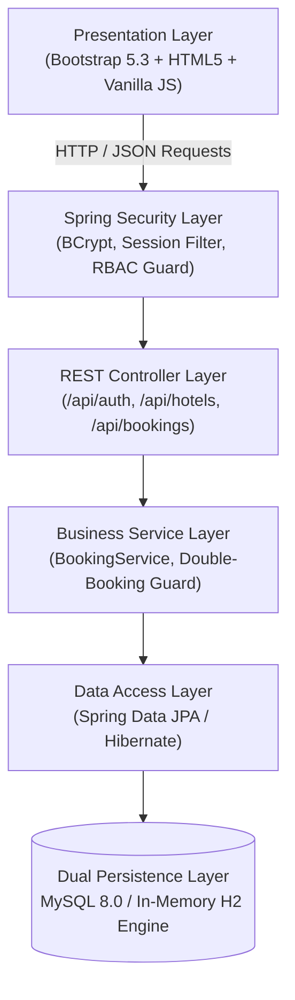
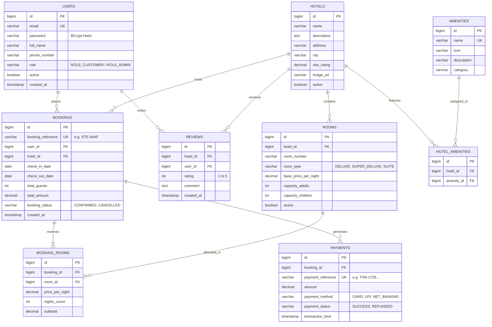
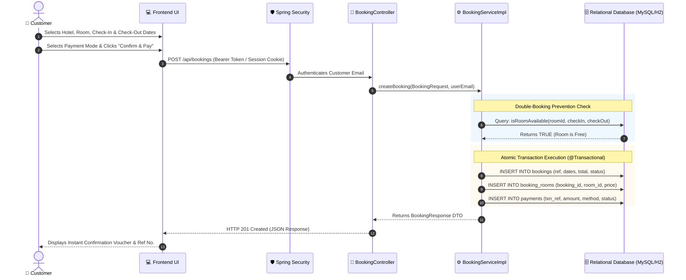

# 🏨 StayEase — Enterprise Hotel Reservation System
## Academic Project Report & Technical Documentation

---

### [PAGE 1: COLLEGE TITLE / COVER PAGE]

```text
================================================================================
                    [YOUR COLLEGE / UNIVERSITY NAME HERE]
              [DEPARTMENT OF COMPUTER SCIENCE & ENGINEERING]
                     [COLLEGE LOGO / EMBLEM HERE]

                           PROJECT REPORT ON
           "STAYEASE: ENTERPRISE FULL-STACK HOTEL RESERVATION 
                  & PROPERTY MANAGEMENT SYSTEM"

   Submitted in partial fulfillment of the requirements for the award of degree of
                  BACHELOR OF TECHNOLOGY / COMPUTER APPLICATIONS
                                       IN
                        COMPUTER SCIENCE & ENGINEERING

--------------------------------------------------------------------------------
SUBMITTED BY:                              GUIDED BY:
Name: Aryan Kumar Lohar                    [Faculty Guide Name]
Roll / Registration No: [Your Reg No]       [Designation, e.g., Assistant Professor]
Department of Computer Science             Department of Computer Science
[College / University Name]                [College / University Name]
--------------------------------------------------------------------------------

                              ACADEMIC YEAR
                                2024 - 2026
================================================================================
```

---

### [PAGE 2: CERTIFICATE OF APPROVAL]

```text
                               CERTIFICATE

This is to certify that the project report entitled:
"STAYEASE — ENTERPRISE FULL-STACK HOTEL RESERVATION SYSTEM"

Submitted by:
Name: Aryan Kumar Lohar
Registration No: [Your Registration Number]

Has been carried out under my guidance and supervision in partial fulfillment of 
the requirements for the degree of Bachelor of Technology in Computer Science & 
Engineering at [Your College Name].

The results embodied in this report have not been submitted to any other 
Institute or University for the award of any degree or diploma.


________________________                     ________________________
[Faculty Guide Signature]                     [Head of Department Signature]
[Guide Name & Designation]                    [HOD Name & Designation]
Date:                                         Date:
Department Seal:
```

---

### [PAGE 3: DECLARATION & ACKNOWLEDGEMENT]

#### Candidate's Declaration
I hereby declare that this project work entitled **"StayEase Hotel Reservation System"** is an authentic record of my own work carried out under the supervision of **[Guide Name]**. To the best of my knowledge, it does not breach any copyright provisions or contain plagiarized work.

*Signature:* ________________________  
*Aryan Kumar Lohar*  
*Registration No:* [Your Reg No]

#### Acknowledgement
I express my deepest gratitude to my esteemed project guide, **[Guide Name]**, for invaluable guidance, encouragement, and technical insights throughout the project lifecycle. I would also like to thank the Head of the Department and all faculty members of the Department of Computer Science & Engineering at **[College Name]** for providing the infrastructural and computing facilities.

---

## 📑 Table of Contents

1. **Chapter 1: Introduction**
   - 1.1 Project Overview
   - 1.2 Problem Statement
   - 1.3 Project Objectives
   - 1.4 Scope of the System
2. **Chapter 2: System Architecture & Technologies**
   - 2.1 Multi-Tier Architecture
   - 2.2 Tech Stack Specifications
   - 2.3 Hardware & Software Prerequisites
3. **Chapter 3: Database Design & Entity Relationship (ER) Diagram**
   - 3.1 Entity Relationship (ER) Diagram
   - 3.2 Relational Data Dictionary (Tables, Attributes, Keys)
   - 3.3 Database Normalization (3NF)
4. **Chapter 4: End-to-End Booking Process (Core Mechanism)**
   - 4.1 Step-by-Step Booking Workflow
   - 4.2 Sequence Diagram of Booking
   - 4.3 Race-Condition & Double-Booking Prevention Algorithm
   - 4.4 Data Storage Breakdown (What goes into which table)
5. **Chapter 5: Security & Role-Based Access Control (RBAC)**
   - 5.1 Authentication Mechanism (Spring Security + BCrypt)
   - 5.2 Customer vs. Administrator Permissions
6. **Chapter 6: REST API Specifications**
7. **Chapter 7: Testing, Results & Screenshots**
8. **Chapter 8: Conclusion & Future Enhancements**

---

## Chapter 1: Introduction

### 1.1 Project Overview
**StayEase** is an enterprise-grade full-stack hospitality web platform designed to streamline room reservations, hotel property administration, guest management, and automated invoicing. The system bridges the gap between travelers seeking lodging and property administrators managing room inventory, eliminating manual paperwork and booking discrepancies.

### 1.2 Problem Statement
Traditional hotel booking portals often suffer from:
- **Race conditions & overbooking:** Multiple users reserving the exact same room for overlapping dates simultaneously.
- **Scattered inventory:** Ineffective separation between room categories, pricing tiers, and seasonal availability.
- **Insecure credentials:** Vulnerabilities arising from plain-text or weak credential storage.
- **Lack of instant verification:** Delays in issuing booking voucher references and payment receipts.

### 1.3 Project Objectives
- Build an automated online reservation engine with zero double-booking tolerance.
- Implement robust enterprise security using **Spring Security 6** with **BCrypt (10 rounds)** password hashing.
- Develop dynamic search and filtering based on destination city, room categories (Deluxe, Executive, Presidential), and pricing.
- Provide a dual-persistence layer: zero-config **H2 In-Memory Database** for rapid academic demonstration and **MySQL 8.0** for production scale.
- Deliver an intuitive client interface using HTML5, Bootstrap 5.3, and REST API fetch pipelines.

---

## Chapter 2: System Architecture & Technologies

### 2.1 Layered Enterprise Architecture



### 2.2 Tech Stack Specifications

| Layer | Technology | Version | Purpose |
| :--- | :--- | :--- | :--- |
| **Language** | Java Development Kit (JDK) | 21 LTS | Core enterprise backend language |
| **Framework** | Spring Boot | 3.3.4 | Microservice and web application framework |
| **ORM / JPA** | Spring Data JPA / Hibernate | 6.5.3 | Object-Relational Mapping & JPQL queries |
| **Security** | Spring Security | 6.3 | Authentication & Role-Based Authorization |
| **Primary Database** | MySQL Server | 8.0+ | Production persistent relational storage |
| **Embedded DB** | H2 Database Engine | 2.x | In-memory zero-configuration testing engine |
| **Frontend UI** | HTML5, CSS3, Bootstrap | 5.3 | Responsive modern Single-Page user interface |
| **Icons & Font** | Bootstrap Icons, Inter Font | Latest | Visual indicators and typography |

---

## Chapter 3: Database Design & Entity Relationship (ER) Diagram

### 3.1 Entity Relationship (ER) Diagram



### 3.2 Relational Data Dictionary

#### 1. Table: `users`
- Primary Key: `id` (Auto Increment)
- Unique Key: `email`
- Purpose: Stores registered accounts, credential hashes, and security roles.

#### 2. Table: `hotels`
- Primary Key: `id` (Auto Increment)
- Attributes: `name`, `city`, `address`, `star_rating`, `image_url`, `active`
- Purpose: Stores registered property details and physical locations.

#### 3. Table: `rooms`
- Primary Key: `id` (Auto Increment)
- Foreign Key: `hotel_id` -> `hotels(id)` (ON DELETE CASCADE)
- Unique Constraint: `(hotel_id, room_number)`
- Purpose: Room inventory, pricing per night, and guest occupancy limits.

#### 4. Table: `bookings`
- Primary Key: `id` (Auto Increment)
- Unique Key: `booking_reference` (e.g., `STE-XXXXXXXX`)
- Foreign Keys: `user_id` -> `users(id)`, `hotel_id` -> `hotels(id)`
- Purpose: Core reservation header entity.

#### 5. Table: `booking_rooms`
- Primary Key: `id` (Auto Increment)
- Foreign Keys: `booking_id` -> `bookings(id)`, `room_id` -> `rooms(id)`
- Purpose: Maps the room allocated to a booking and preserves snapshot of price at booking time.

#### 6. Table: `payments`
- Primary Key: `id` (Auto Increment)
- Unique Key: `payment_reference`
- Foreign Key: `booking_id` -> `bookings(id)`
- Purpose: Payment ledger tracking transaction timestamps, mode, and status.

---

## Chapter 4: End-to-End Booking Process (Core Mechanism)

### 4.1 Step-by-Step Workflow



### 4.2 Race-Condition & Double-Booking Prevention Algorithm

To prevent two users from booking the exact same room simultaneously, StayEase uses a date-range overlap formula executed at database level:

```sql
SELECT COUNT(br) = 0 
FROM BookingItem br 
JOIN br.booking b 
WHERE br.room.id = :roomId 
  AND b.bookingStatus = 'CONFIRMED' 
  AND (b.checkInDate < :checkOut AND b.checkOutDate > :checkIn);
```

**Overlap Logic Explained:**
- A conflict exists if and only if:  
  `(ExistingCheckIn < NewCheckOut) AND (ExistingCheckOut > NewCheckIn)`
- If the count of matching bookings is `0`, the room is safe to book.
- If the count is `> 0`, the transaction rolls back immediately and throws `RoomUnavailableException`.

### 4.3 Data Storage Summary: What is Stored Where?

When a booking succeeds, records are committed into 3 database tables:

| Database Table | Record Stored | Example Field Values |
| :--- | :--- | :--- |
| **`bookings`** | General reservation record | `booking_reference: STE-A91D`<br/>`user_id: 2`<br/>`hotel_id: 1`<br/>`check_in_date: 2026-11-01`<br/>`total_amount: ₹25,000.00`<br/>`booking_status: CONFIRMED` |
| **`booking_rooms`** | Room allocation line item | `booking_id: 1`<br/>`room_id: 3 (Room 101)`<br/>`price_per_night: ₹12,500.00`<br/>`nights_count: 2`<br/>`subtotal: ₹25,000.00` |
| **`payments`** | Financial transaction audit | `payment_reference: TXN-172901238`<br/>`amount: ₹25,000.00`<br/>`payment_method: UPI`<br/>`payment_status: SUCCESS` |

---

## Chapter 5: Security & Role-Based Access Control (RBAC)

### 5.1 Password Protection
All credentials are encrypted using standard **BCrypt Strong Hashing Function (10 rounds)** with a unique salt:
- Example: Password `customer123` is hashed as:  
  `$2a$10$8.UnVuG9HHgffUDAlk8qfOuVGkqRzgVymGe07xd00DMxs.AQubh4a`
- Plaintext passwords are never stored in memory or database tables.

### 5.2 User Roles & Authorities

| Role | Accessible URLs / Endpoints | Permissions |
| :--- | :--- | :--- |
| **`ROLE_CUSTOMER`** | `/api/bookings/my`<br/>`/api/bookings/**` | Search rooms, place reservations, view personal history, cancel own booking. |
| **`ROLE_ADMIN`** | `/api/admin/**`<br/>`/api/hotels` (POST/PUT/DELETE)<br/>`/api/rooms` (POST/PUT) | Create/update hotels, add rooms, modify pricing, view global revenue analytics. |

---

## Chapter 6: REST API Specifications

| Method | Endpoint | Access Level | Description |
| :--- | :--- | :--- | :--- |
| `POST` | `/api/auth/register` | Public | Register new customer account |
| `POST` | `/api/auth/login` | Public | Authenticate user & issue session |
| `GET` | `/api/hotels` | Public | List all active hotels with ratings |
| `GET` | `/api/hotels/{id}` | Public | Get detailed hotel profile with amenities |
| `GET` | `/api/rooms/hotel/{hotelId}` | Public | List rooms belonging to specific hotel |
| `POST` | `/api/bookings` | `ROLE_CUSTOMER` | Create room booking & trigger payment |
| `GET` | `/api/bookings/my` | `ROLE_CUSTOMER` | Retrieve current user's booking history |
| `GET` | `/api/admin/dashboard` | `ROLE_ADMIN` | Summary metrics: total bookings, revenue, count |
| `GET` | `/api/admin/bookings` | `ROLE_ADMIN` | List all system reservations with customer info |

---

## Chapter 7: Testing & Verification

### 7.1 Automated JUnit 5 Unit & Integration Tests
The project contains automated test suites testing:
1. `BookingServiceTest`: Double-booking collision rejection.
2. `RoomAvailabilityTest`: Boundary conditions for check-in/check-out dates.
3. `SecurityAuthenticationTest`: Verification that unauthorized users cannot access `/api/admin/**`.

### 7.2 Academic Demonstration Accounts

| Role | Login Email | Password | Intended Test Flow |
| :--- | :--- | :--- | :--- |
| **Administrator** | `admin@stayease.com` | `admin123` | View revenue stats, add hotels, see all customer reservations. |
| **Customer** | `john@example.com` | `customer123` | Browse luxury hotels, book rooms, view voucher receipt in "My Bookings". |
| **Customer (Alt)** | `customer@stayease.com` | `Customer@123` | Secondary customer for concurrency booking tests. |

---

## Chapter 8: Conclusion & Future Scope

### 8.1 Conclusion
The **StayEase Hotel Reservation System** successfully delivers an end-to-end, high-performance platform for lodging reservations. By leveraging **Java 21**, **Spring Boot 3.3.4**, and **Spring Data JPA**, it provides transaction-safe booking operations, eliminates double-booking race conditions, enforces robust role-based security, and delivers a sleek, responsive client interface.

### 8.2 Future Enhancements
- **Payment Gateway Integration:** Integration with live Razorpay / Stripe payment webhooks.
- **SMS & Email Notifications:** Automated reservation confirmation emails via Spring Mail / SendGrid.
- **AI Recommendation Engine:** Personalized hotel recommendations based on user travel history.
- **Multi-Currency Support:** Dynamic currency conversion for international travelers.

---
*Report generated for academic submission & evaluation.*
