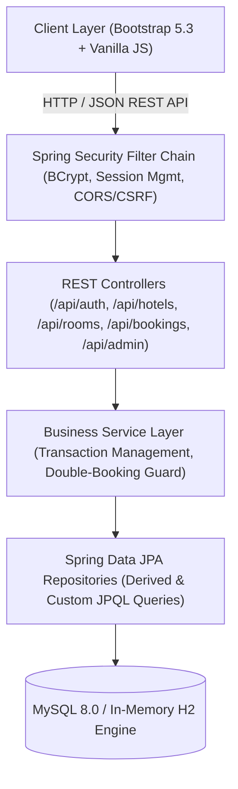
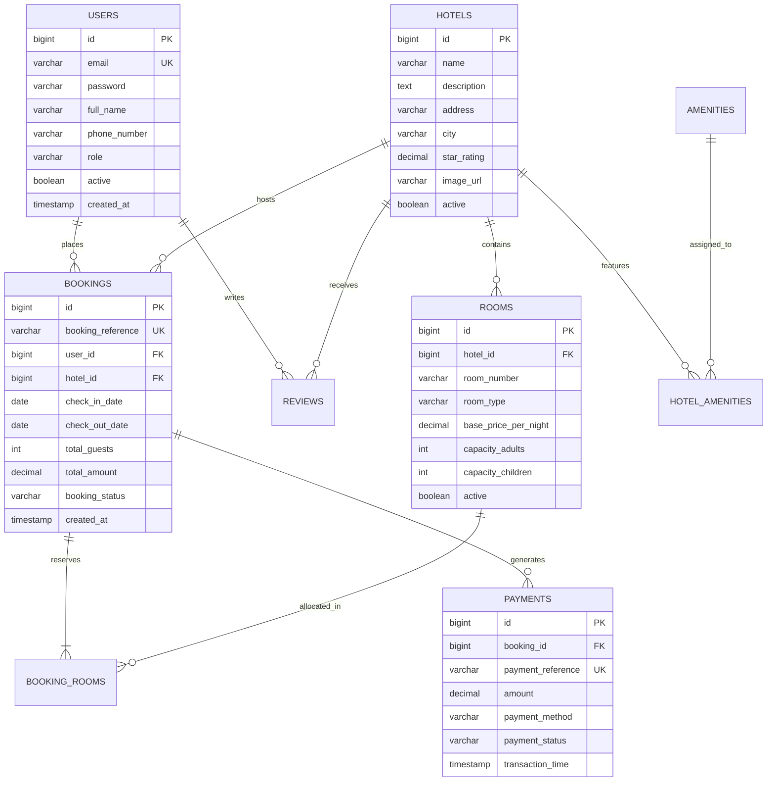

# 🏨 StayEase — Enterprise Hotel Reservation & Property Management System

[](https://www.oracle.com/java/)
[](https://spring.io/projects/spring-boot)
[](https://spring.io/projects/spring-security)
[](https://www.mysql.com/)
[](https://getbootstrap.com/)
[](https://github.com/Aryanlohar7100/Hotel-Reservation-System/actions)
[](LICENSE)

> **StayEase** is an enterprise-grade full-stack hospitality management platform designed to deliver high-concurrency room reservations, automated double-booking prevention, role-based access control, real-time analytics, and voucher receipts. Built with **Java 21**, **Spring Boot 3.3.4**, **Spring Data JPA/Hibernate**, **MySQL 8 / H2**, and a **Bootstrap 5.3** client application.

---

## 📖 Table of Contents
- [Architecture & Design](#-system-architecture)
- [Key Engineering Highlights](#-key-engineering-highlights)
- [Database Schema (ER Diagram)](#-database-schema--entity-relationships)
- [Quick Start Guide](#-quick-start-guide)
- [Demonstration Accounts](#-demonstration-accounts)
- [REST API Specifications](#-rest-api-specifications)
- [Automated Unit Testing](#-automated-unit-testing)
- [Project Directory Structure](#-project-directory-structure)
- [Viva & Technical Interview Guide](#-viva--technical-interview-guide)
- [Author & Contact](#-author)

---

## 🏛 System Architecture

StayEase follows a modern layered enterprise architecture adhering to separation of concerns:



---

## ⚡ Key Engineering Highlights

1. **Race-Condition & Double-Booking Prevention**:
   - Implements transactional date-interval collision detection queries (`check_in_date < :checkOut AND check_out_date > :checkIn`).
   - Prevents duplicate room allocations even under simultaneous booking requests.
2. **Enterprise Authentication & RBAC**:
   - Integrated with **Spring Security** using `BCryptPasswordEncoder` (10 rounds).
   - Segregated role boundaries (`ROLE_ADMIN` vs `ROLE_CUSTOMER`) with declarative method security (`@PreAuthorize`).
3. **Dual Persistence Strategy**:
   - **Production Profile (`mysql`)**: Production-ready MySQL 8 with HikariCP connection pooling, indexed foreign keys, and unique constraints.
   - **Local Testing Profile (`h2`)**: Zero-dependency in-memory H2 database with automatic schema bootstrapping and demo data seeding.
4. **Interactive Single-Page Client Application**:
   - Built with modern HTML5, Bootstrap 5.3, Bootstrap Icons, and Vanilla JavaScript with fetch API.
   - Features real-time price calculations, interactive room availability checks, and customer & administrator dashboards.

---

## 🗄 Database Schema & Entity Relationships



---

## 🚀 Quick Start Guide

### Prerequisites
- **Java Development Kit (JDK):** Version 21 or higher
- **Maven:** 3.9+ (or use the included wrapper `./mvnw`)

---

### Option 1: Instant Run with H2 In-Memory Database (Zero Setup)
No MySQL installation required. Starts immediately with pre-loaded demo hotels and credentials:

```bash
# Clone the repository
git clone https://github.com/Aryanlohar7100/Hotel-Reservation-System.git
cd Hotel-Reservation-System

# Run with H2 active profile
./mvnw spring-boot:run -Dspring-boot.run.profiles=h2
```

👉 **Access the App:** [http://localhost:8080](http://localhost:8080)  
👉 **H2 Database Console:** [http://localhost:8080/h2-console](http://localhost:8080/h2-console) (`JDBC URL: jdbc:h2:mem:stayease_db`, `Username: sa`, `Password: `)

---

### Option 2: Run with MySQL 8.0 (Production Setup)
1. Ensure MySQL is running on port `3306`.
2. Execute the schema and seed scripts:
   ```bash
   mysql -u root -p < database/schema.sql
   mysql -u root -p < database/seed-data.sql
   ```
3. Set your environment variables and start the server:
   ```bash
   export DB_URL="jdbc:mysql://localhost:3306/stayease_db?createDatabaseIfNotExist=true&useSSL=false&serverTimezone=UTC&allowPublicKeyRetrieval=true"
   export DB_USERNAME="root"
   export DB_PASSWORD="your_password"

   ./mvnw spring-boot:run
   ```

---

## 🔑 Demonstration Accounts

| Role | Email Address | Password | Permissions & Dashboard |
| :--- | :--- | :--- | :--- |
| **Administrator** | `admin@stayease.com` | `admin123` | Full administrative control, revenue metrics, booking management, hotel/room status |
| **Customer** | `john@example.com` | `customer123` | Room search, live reservations, personal voucher views, cancellation handling |
| **Customer** | `priya.sharma@example.com` | `customer123` | Room booking, property reviews, and rating submission |

*(Quick-fill buttons are provided on the login page for instantaneous 1-click authentication).*

---

## 📡 REST API Specifications

### Authentication (`/api/auth`)
| Method | Endpoint | Access | Description |
| :--- | :--- | :--- | :--- |
| `POST` | `/api/auth/register` | Public | Register new customer account |
| `POST` | `/api/auth/login` | Public | Authenticate user & create secure session |
| `POST` | `/api/auth/logout` | Authenticated | Invalidate current session |
| `GET` | `/api/auth/me` | Authenticated | Fetch current authenticated user profile |

### Hotels & Search (`/api/hotels`)
| Method | Endpoint | Access | Description |
| :--- | :--- | :--- | :--- |
| `GET` | `/api/hotels` | Public | Search hotels by `city`, `minRating`, `keyword` |
| `GET` | `/api/hotels/{id}` | Public | Retrieve full hotel details |
| `GET` | `/api/hotels/cities` | Public | Retrieve distinct destination cities |
| `POST` | `/api/hotels` | Admin | Create a new hotel property |
| `PUT` | `/api/hotels/{id}` | Admin | Update hotel property details |
| `DELETE` | `/api/hotels/{id}` | Admin | Deactivate/remove hotel property |

### Rooms & Inventory (`/api/rooms`)
| Method | Endpoint | Access | Description |
| :--- | :--- | :--- | :--- |
| `GET` | `/api/rooms/hotel/{hotelId}` | Public | List all rooms for a hotel |
| `GET` | `/api/rooms/available` | Public | Real-time availability filter (`checkIn`, `checkOut`, `capacity`) |
| `GET` | `/api/rooms/{id}` | Public | View room specifics |
| `POST` | `/api/rooms` | Admin | Register new room inventory unit |

### Reservations & Transactions (`/api/bookings`)
| Method | Endpoint | Access | Description |
| :--- | :--- | :--- | :--- |
| `POST` | `/api/bookings` | Customer | Create atomic reservation and payment record |
| `GET` | `/api/bookings/my-bookings` | Customer | Retrieve customer's personal reservation history |
| `GET` | `/api/bookings/reference/{ref}` | Customer | Download digital voucher by reference string |
| `PUT` | `/api/bookings/{id}/cancel` | Customer/Admin | Cancel booking and trigger refund status |

### Hospitality Administration (`/api/admin`)
| Method | Endpoint | Access | Description |
| :--- | :--- | :--- | :--- |
| `GET` | `/api/admin/stats` | Admin | Dashboard metrics: Total Revenue, Occupancy Rate, Total Bookings |
| `GET` | `/api/admin/bookings` | Admin | Global audit list of all bookings across all hotels |
| `PUT` | `/api/admin/bookings/{id}/status` | Admin | Transition booking state (`CONFIRMED`, `CHECKED_IN`, `COMPLETED`, `CANCELLED`) |
| `GET` | `/api/admin/customers` | Admin | View registered customer directory |
| `PUT` | `/api/admin/customers/{id}/toggle-status` | Admin | Activate/deactivate customer account |

---

## 🧪 Automated Unit Testing

The project includes an automated JUnit 5 test suite validating service-layer business rules and edge cases:

```bash
./mvnw clean test
```

### Test Coverage Highlights:
- ✅ `testCreateBooking_Success` — Validates correct booking creation, reference generation, and payment ledger record.
- ✅ `testCreateBooking_DoubleBookingConflict` — Verifies rejection of overlapping date intervals (`RoomUnavailableException`).
- ✅ `testCreateBooking_InvalidDates` — Verifies rejection of inverted or past dates (`InvalidBookingException`).
- ✅ `testCreateBooking_ExceedCapacity` — Ensures guests do not exceed room capacity limits.
- ✅ `testCancelBooking_Success` — Verifies status transition to `CANCELLED` and payment state to `REFUNDED`.
- ✅ `testRegister_Success` — Asserts BCrypt password encoding and `ROLE_CUSTOMER` assignment.
- ✅ `testRegister_DuplicateEmail` — Rejects duplicate email registration with custom validation response.

---

## 📂 Project Directory Structure

```text
Hotel-Reservation-System/
├── .github/
│   └── workflows/
│       └── ci.yml                     # GitHub Actions Automated CI Pipeline
├── database/
│   ├── schema.sql                     # Production MySQL 8 Relational Schema
│   └── seed-data.sql                  # Realistic Sample Data & Hotels
├── src/
│   ├── main/
│   │   ├── java/com/stayease/
│   │   │   ├── config/                # SecurityConfig, DataSeeder, DataLoader
│   │   │   ├── controller/            # REST Controllers (Auth, Booking, Hotel, Admin)
│   │   │   ├── dto/                   # Request & Response DTO records
│   │   │   ├── entity/                # JPA Domain Entities (User, Hotel, Room, Booking)
│   │   │   ├── exception/             # GlobalExceptionHandler & Custom Exceptions
│   │   │   ├── repository/            # Spring Data JPA Repositories
│   │   │   ├── security/              # UserPrincipal, CustomUserDetailsService
│   │   │   ├── service/               # Service Interfaces & Implementations
│   │   │   └── StayEaseApplication.java
│   │   └── resources/
│   │       ├── static/                # HTML5, Bootstrap 5.3 UI, CSS & JS modules
│   │       ├── application.yml        # MySQL Production Configuration
│   │       └── application-h2.yml     # Zero-Setup In-Memory H2 Configuration
│   └── test/
│       └── java/com/stayease/service/ # Automated JUnit 5 Mockito Test Suite
├── .gitignore                         # Comprehensive Ignore for Target & System Files
├── CONTRIBUTING.md                    # Open Source Contribution Standards
├── LICENSE                            # MIT License
├── pom.xml                            # Maven Dependencies & Build Definitions
├── README.md                          # Repository Documentation & Architecture
└── VIVA_QUESTIONS_AND_ANSWERS.md      # Comprehensive Viva & Technical Interview Prep
```

---

## 🎓 Viva & Technical Interview Guide

For university examinations, project vivas, and technical interviews, an extensive guide is provided in [VIVA_QUESTIONS_AND_ANSWERS.md](VIVA_QUESTIONS_AND_ANSWERS.md).

It contains:
- Complete breakdown of technical architecture & design decisions
- Explanation of ACID transactions & concurrency control in hotel booking
- Why Spring Data JPA / Hibernate was chosen over raw JDBC
- Top 35 viva questions with detailed model answers covering Spring Boot, Security, JPA, and Database Normalization.

---

## 👨‍💻 Author

**Aryan Kumar Lohar**  
*B.Tech in Computer Science & Engineering*  
- **GitHub:** [@Aryanlohar7100](https://github.com/Aryanlohar7100)  
- **Repository:** [Hotel-Reservation-System](https://github.com/Aryanlohar7100/Hotel-Reservation-System)  

---

## 📄 License
This project is open-source and licensed under the [MIT License](LICENSE).
